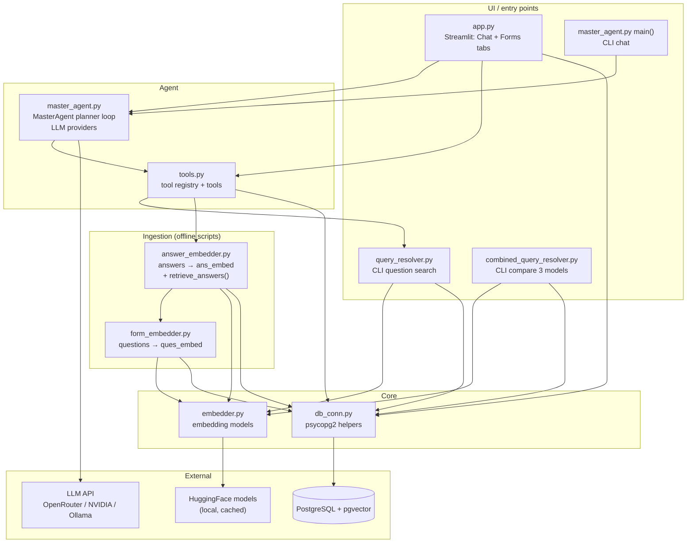
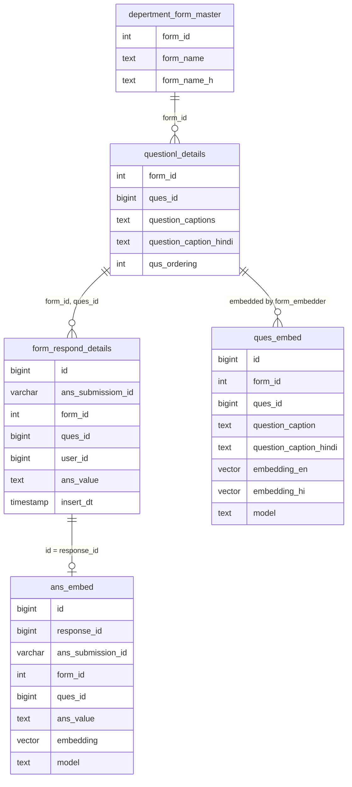

# Architecture

Parakh assistant: a RAG + tool-calling agent over Madhya Pradesh inspection
forms. Officers ask in English, Hindi or Hinglish; an LLM planner calls tools
that search embedded **questions** and **answers** in PostgreSQL (pgvector)
and replies in plain language.

See [flow.md](./flow.md) for step-by-step flows.

## Layers

## Files

| File | Role | Main functions |
|---|---|---|
| `app.py` | Streamlit UI. **Chat** tab talks to the agent; **Forms** tab lists embedded forms and shows their questions. | `show_details`, `embedded_forms`, `show_form` |
| `master_agent.py` | LLM planner loop. Each step the LLM returns JSON: `call_tool`, `final` or `clarify`. Falls back to plain search if the LLM fails. Holds the system prompt (`PLANNER_SYSTEM`) and LLM clients. | `MasterAgent.handle/_run/_decide/_fallback`, `default_llm`, `openrouter_chat`, `nvidia_chat`, `ollama_chat`, `LLMS` |
| `tools.py` | Tool registry (`@tool`) and every tool the agent can call. Validates args in `call_tool`. | `call_tool`, `describe_tools`, tools listed below |
| `query_resolver.py` | Vector search over `ques_embed` (EN + HI vectors). Also a CLI. | `retrieve_top_k`, `resolve_query` |
| `combined_query_resolver.py` | CLI: runs the question search on all 3 models and prints comparison tables. Not used by the agent. | `retrieve_model_matches`, `resolve_all_models` |
| `form_embedder.py` | Offline: embeds question captions (EN + HI) of a form (or `*` all) into `ques_embed`. | `embed_form`, `fetch_form_questions`, `prepare_embedding_rows`, `insert_form_embeddings` |
| `answer_embedder.py` | Offline: embeds answers of one form into `ans_embed`; also the answer search used by the agent. | `embed_answers`, `retrieve_answers`, `answer_text`, `embed_distinct` |
| `embedder.py` | Loads and caches embedding models, returns numpy vectors. | `embedder`, `MODEL_OPTIONS`, `MODEL_STORAGE_NAMES`, `DEFAULT_MODEL_NAME` |
| `db_conn.py` | PostgreSQL connection from `.env`; returns rows as JSON. | `execute`, `execute_many`, `get_db_connection` |
| `embedding_scheduler.py` | **Legacy**: writes vectors into `questionl_details` directly. Not used by the current flow. | — |
| `main.py` | Scratch test of `embedder`. | — |
| `sql/ques_embed.sql`, `sql/ans_embed.sql` | DDL for the two embedding tables. | — |

## Agent tools (`tools.py`)

| Tool | Reads | Calls | Used for |
|---|---|---|---|
| `search_questions` | `ques_embed` | `query_resolver.retrieve_top_k` (per phrasing, fused by RRF) | Find form fields/questions on a topic |
| `get_form_questions` | `questionl_details` | `_db_rows` | List all questions of one form (also used by the Forms tab) |
| `list_forms` | `ques_embed` | `_db_rows` | Which forms are embedded |
| `search_answers` | `ans_embed` ⟕ `ques_embed` | `answer_embedder.retrieve_answers` | Semantic search over submitted answers of a form |
| `answer_summary` | `form_respond_details` | `_db_rows` + `answer_text` | Count of each distinct answer for one question |
| `get_submission` | `form_respond_details` ⟕ `questionl_details` | `_db_rows` + `answer_text` | Every answer of one submission |
| `query_submission_data` | — | raises `NotImplementedError` | Placeholder for future NL→SQL |

## Database

- **Source tables** (from the Parakh app): `depertment_form_master`, `questionl_details`, `form_respond_details`.
- **Derived tables** (ours): `ques_embed` (unique `model, ques_id`), `ans_embed` (unique `model, response_id`).
- Vectors are untyped `vector` because the three models have different dimensions; every search filters by `model`.
- Option answers are stored as JSON (`[{"OptionID":"1","OptionText":"Rural"}]`); `answer_text()` turns them into readable text before embedding or showing them to the LLM.

## Configuration (`.env`)

| Variable | Used by |
|---|---|
| `PGHOST`, `PGPORT`, `PGDATABASE`, `DB_USER`, `DB_PASS` | `db_conn.py` |
| `LLM_PROVIDER` (`openrouter` / `nvidia` / `ollama`) | `master_agent.default_llm` |
| `OPENROUTER_API_KEY`, `OPENROUTER_MODEL`, `OPENROUTER_URL` | `openrouter_chat` |
| `NVIDIA_API_KEY`, `NVIDIA_MODEL`, `NVIDIA_URL` | `nvidia_chat` |
| `OLLAMA_HOST`, `OLLAMA_MODEL` | `ollama_chat` |

## Embedding models (`embedder.py`)

| Model id | Stored as `model` |
|---|---|
| `BAAI/bge-m3` | `bge-m3` |
| `krutrim-ai-labs/vyakyarth` (default) | `krutrim-ai-labs/vyakyarth` |
| `google/embeddinggemma-300m` | `google/embeddinggemma-300m` |

The query must be embedded with the **same model** that embedded the stored
rows. Ingestion scripts use `embedder.MODEL_NAME`; the Streamlit embedding
selector sets `MasterAgent.embedding_model`, which `_run` copies into
`tools.EMBEDDING_MODEL` for the search tools.
