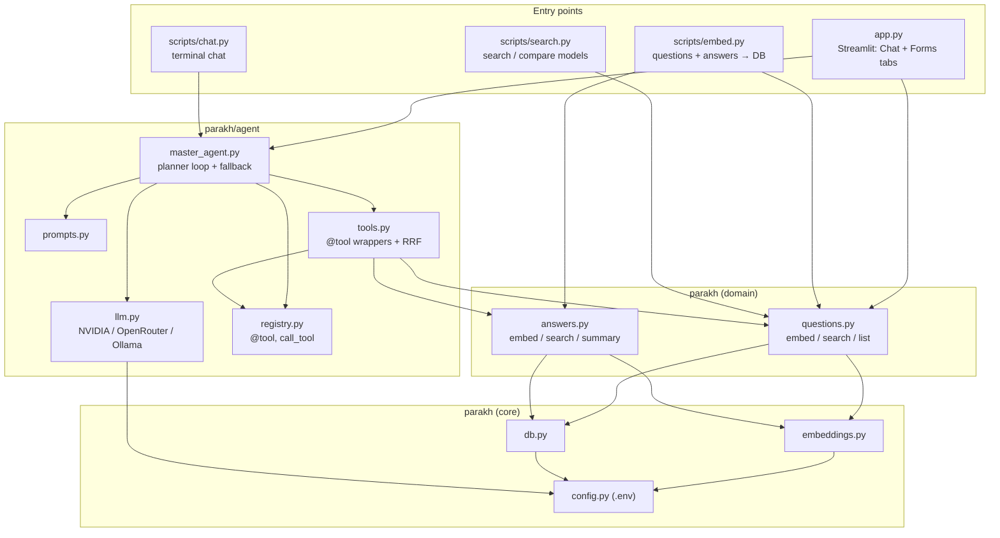
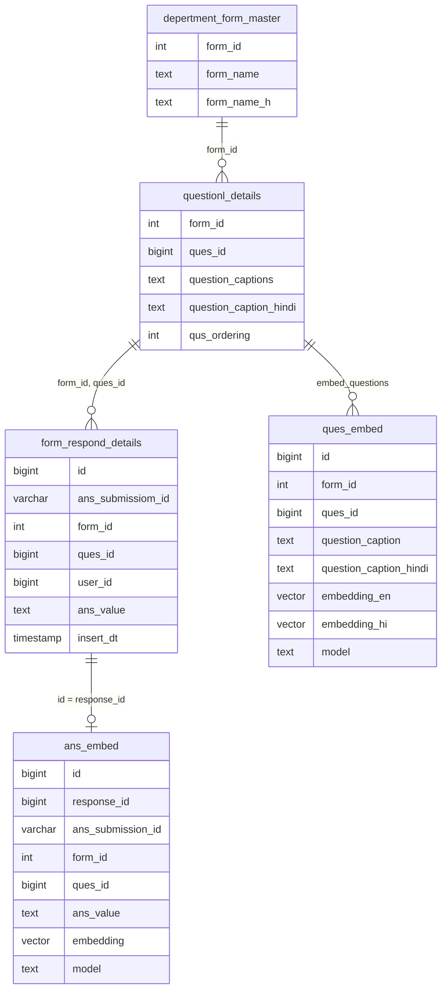

# Architecture

Parakh assistant: a RAG + tool-calling agent over Madhya Pradesh inspection
forms. Officers ask in English, Hindi or Hinglish; an LLM planner calls tools
that search embedded **questions** and **answers** in PostgreSQL (pgvector)
and replies in plain language.

See [flow.md](./flow.md) for step-by-step flows.

## Layers

Each layer only imports from the layers below it.

## Files

| File | Role |
|---|---|
| `app.py` | Streamlit UI. Sidebar picks the LLM and embedding model. **Chat** tab talks to the agent; **Forms** tab lists embedded forms and their questions. |
| `parakh/config.py` | Every setting: DB, LLM keys/models, `EMBEDDING_MODELS`, defaults, `IMAGE_BASE_URL`. Loads `.env` once. |
| `parakh/db.py` | `fetch(query, params) -> list[dict]`, `execute_many(query, rows)`. |
| `parakh/embeddings.py` | `embed()` (cached models), `embed_unique()` (each distinct text once → pgvector text), `to_pgvector()`. |
| `parakh/questions.py` | `embed_questions`, `search_questions`, `get_form_questions`, `list_forms`. |
| `parakh/answers.py` | `answer_text`, `image_urls`, `embed_answers`, `answered_form_ids`, `search_answers`, `get_submission`, `answer_summary`. |
| `parakh/agent/llm.py` | LLM clients, `LLMS` (UI list, NVIDIA first), `default_llm`, `extract_json`. |
| `parakh/agent/prompts.py` | `PLANNER_SYSTEM`. |
| `parakh/agent/registry.py` | `@tool`, `describe_tools`, `call_tool` (validates + coerces LLM arguments). |
| `parakh/agent/tools.py` | The tools below. Thin wrappers over `questions` / `answers`. |
| `parakh/agent/master_agent.py` | `MasterAgent`: each step the LLM returns `call_tool`, `final` or `clarify`; falls back to plain search if the LLM fails. |
| `scripts/` | Interactive scripts (`embed`, `search`, `chat`) + shared input helpers in `__init__.py`. |
| `tests/test_core.py` | Checks with fakes; no DB, model or LLM needed. |
| `sql/*.sql` | DDL for `ques_embed` and `ans_embed`. |

## Agent tools (`parakh/agent/tools.py`)

| Tool | Reads | Calls | Used for |
|---|---|---|---|
| `search_questions` | `ques_embed` | `questions.search_questions` per phrasing, fused by RRF | Find form fields/questions on a topic |
| `get_form_questions` | `questionl_details` | `questions.get_form_questions` | List all questions of one form |
| `list_forms` | `ques_embed` ⟕ `depertment_form_master` | `questions.list_forms` | Which forms are embedded |
| `search_answers` | `ans_embed` ⟕ `ques_embed` | `answers.search_answers` | Semantic search over submitted answers of a form |
| `answer_summary` | `form_respond_details` | `answers.answer_summary` | Count of each distinct answer for one question |
| `get_submission` | `form_respond_details` ⟕ `questionl_details` | `answers.get_submission` | Every answer of one submission |
| `query_submission_data` | — | raises `NotImplementedError` | Placeholder for future NL→SQL |

## Database

- **Source tables** (from the Parakh app): `depertment_form_master`, `questionl_details`, `form_respond_details`.
- **Derived tables** (ours): `ques_embed` (unique `model, ques_id`), `ans_embed` (unique `model, response_id`).
- Vectors are untyped `vector` because the three models have different dimensions; every search filters by `model`.
- Option answers are stored as JSON (`[{"OptionID":"1","OptionText":"Rural"}]`); `answer_text()` turns them into readable text before embedding or showing them to the LLM.

## Configuration (`.env`, see `.env.example`)

| Variable | Used by |
|---|---|
| `PGHOST`, `PGPORT`, `PGDATABASE`, `DB_USER`, `DB_PASS` | `db.py` |
| `LLM_PROVIDER` (`nvidia` default / `openrouter` / `ollama`) | `llm.default_llm` |
| `NVIDIA_API_KEY`, `NVIDIA_MODEL`, `NVIDIA_URL` | `nvidia_chat` |
| `OPENROUTER_API_KEY`, `OPENROUTER_MODEL`, `OPENROUTER_URL` | `openrouter_chat` |
| `OLLAMA_HOST`, `OLLAMA_MODEL` | `ollama_chat` |
| `IMAGE_BASE_URL` | `answers.image_urls` |

## Embedding models (`config.EMBEDDING_MODELS`)

| Model id | Stored as `model` |
|---|---|
| `krutrim-ai-labs/vyakyarth` (default) | `krutrim-ai-labs/vyakyarth` |
| `BAAI/bge-m3` | `bge-m3` |
| `google/embeddinggemma-300m` | `google/embeddinggemma-300m` |

The query must be embedded with the **same model** that embedded the stored
rows. `scripts/embed.py` asks for the model (Enter = Vyakyarth); the Streamlit
sidebar sets `MasterAgent.embedding_model`, which `_run` copies into
`tools.EMBEDDING_MODEL` for the search tools.
