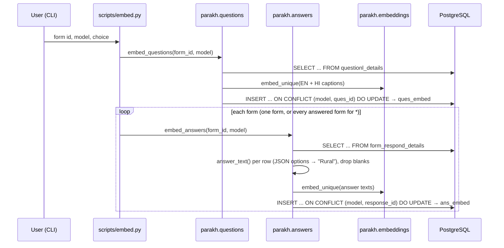
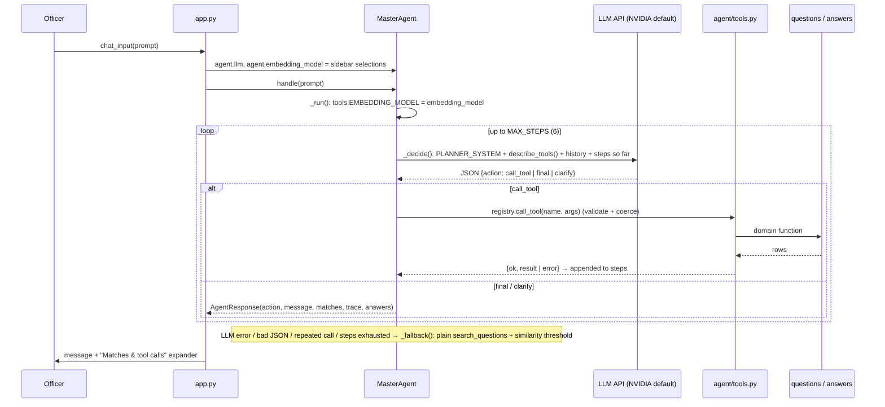

# Flows

Who calls what, step by step. For the component overview see
[architecture.md](./architecture.md).

## 1. Ingestion: questions + answers in one go

`python -m scripts.embed` → form id (or `*`), model (Enter = Vyakyarth),
what to embed (Enter = questions + answers)

Progress is logged to the console and `parakh.log`.

## 2. Chat request (main flow)

`streamlit run app.py` → Chat tab (or `python -m scripts.chat`)

`MasterAgent.handle` also appends the user message and reply to
`self.history`; the last 6 turns go into every `_decide` prompt, so follow-ups
like "show the full submission" resolve against earlier turns.

### Typical tool chains the planner uses

| User asks | Tool chain |
|---|---|
| "Which questions are about toilets?" | `search_questions` → final |
| "What does form 459 contain?" | `get_form_questions` → final |
| "How was the counsellor question answered?" | `search_questions` (find form_id, ques_id) → `answer_summary` → final |
| "Find hostels reporting broken toilets in form 459" | `search_answers` (optionally after `search_questions` for ques_id) → final |
| "Show that full inspection" | `search_answers` → `get_submission(ans_submission_id)` → final |
| "Hi" | final (no tool) |
| "status" (too vague) | clarify |

## 3. Forms tab

`app.py` → `cached_forms(model)` (5 min cache) → `questions.list_forms(model)`
(form master join; ids only if that table is missing) → table with a **View**
button → `questions.get_form_questions(form_id)` in a dialog.

## 4. Search / model comparison

`python -m scripts.search` → query, form id (blank = all), model (`a` = all)
→ `questions.search_questions()` per model → one table per model, plus a
"best similarity per question and model" pivot when comparing.

## Setup order on a fresh database

1. Copy `.env.example` to `.env` and fill it in.
2. `psql -f sql/ques_embed.sql` and `psql -f sql/ans_embed.sql`.
3. `python -m scripts.embed` (per form or `*`).
4. `streamlit run app.py`.
