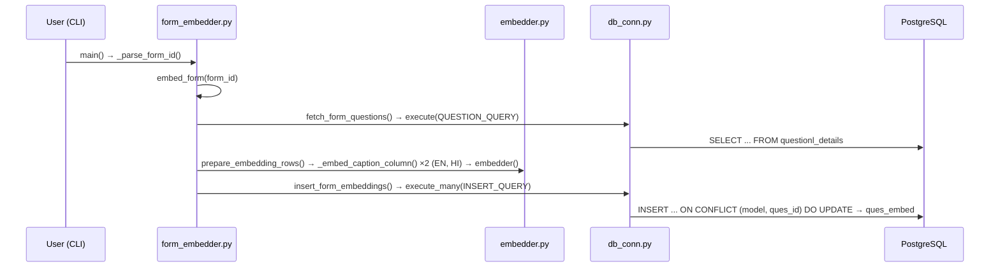
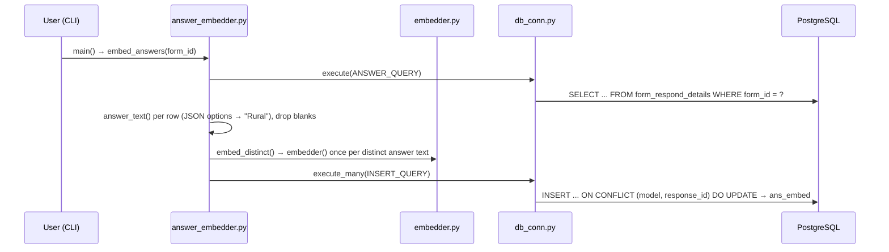
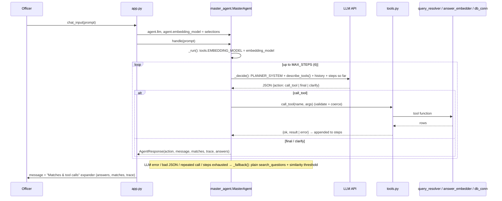
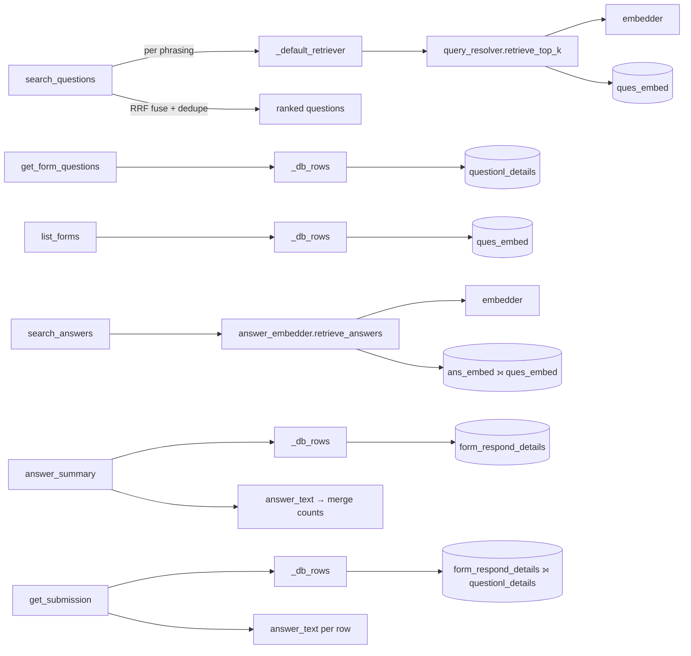
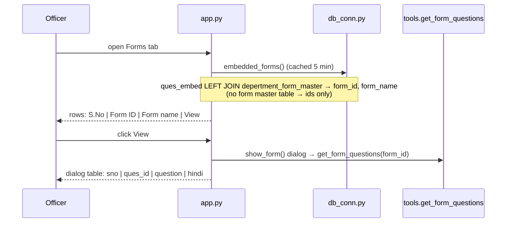

# Flows

Who calls what, step by step. For the component overview see
[architecture.md](./architecture.md).

## 1. Ingestion: question embeddings

`python form_embedder.py` → enter a form id (or `*` for all forms)

## 2. Ingestion: answer embeddings

`python answer_embedder.py` → enter a form id

Logging for both scripts goes to `form_embedder.log` (`answer_embedder` reuses
`form_embedder.configure_logging/log_message`).

## 3. Chat request (main flow)

`streamlit run app.py` → Chat tab

`MasterAgent.handle` also appends the user message and reply to
`self.history`; the last 6 turns go into every `_decide` prompt, so follow-ups
like "show the full submission" resolve against earlier turns.

### Typical tool chains the planner uses

| User asks | Tool chain |
|---|---|
| "Which questions are about toilets?" | `search_questions` → final |
| "What does form 459 contain?" | `get_form_questions` → final |
| "How was the counsellor question answered?" | `search_questions` (find form_id, ques_id) → `answer_summary` → final |
| "Find hostels reporting broken toilets in form 459" | `search_answers` (optionally after `search_questions` for ques_id) → final |
| "Show that full inspection" | `search_answers` → `get_submission(ans_submission_id)` → final |
| "Hi" | final (no tool) |
| "status" (too vague) | clarify |

### What each tool calls

All `_db_rows` / `retrieve_*` calls go through `db_conn.execute`, which opens a
connection, runs the query and returns rows as a JSON string.

## 4. Forms tab

## 5. Standalone CLIs (not used by the agent)

- `python query_resolver.py` → `main()` → `resolve_query()` → `retrieve_top_k()` → prints matching questions as JSON.
- `python combined_query_resolver.py` → `main()` → `resolve_all_models()` → `retrieve_model_matches()` for each model → `print_table()` per model + combined comparison.
- `python master_agent.py` → `main()` → `MasterAgent.handle()` loop in the terminal, printing the trace.

## Setup order on a fresh database

1. Fill `.env` (DB + LLM keys).
2. `psql -f sql/ques_embed.sql` and `psql -f sql/ans_embed.sql`.
3. `python form_embedder.py` (per form or `*`).
4. `python answer_embedder.py` (per form).
5. `streamlit run app.py`.
